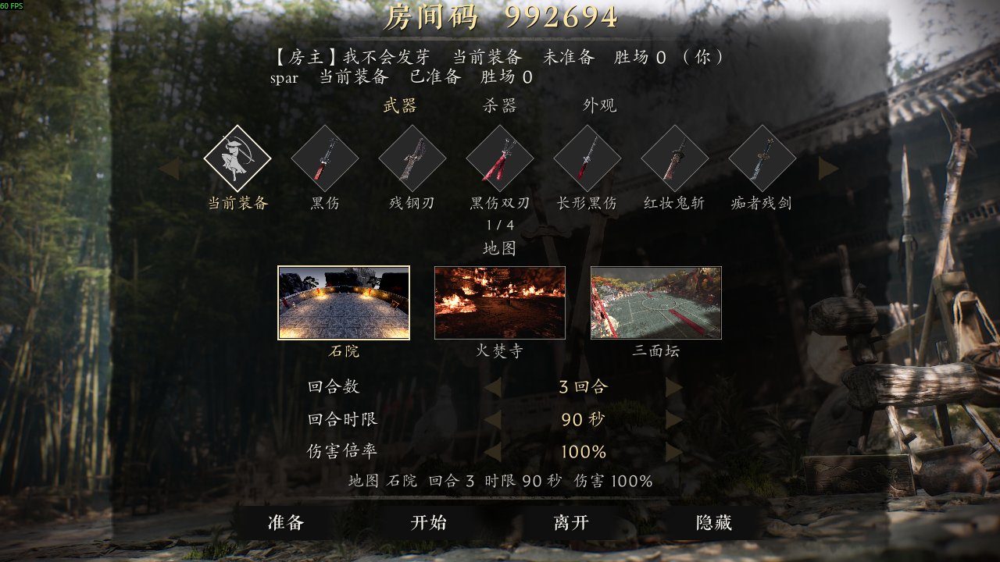
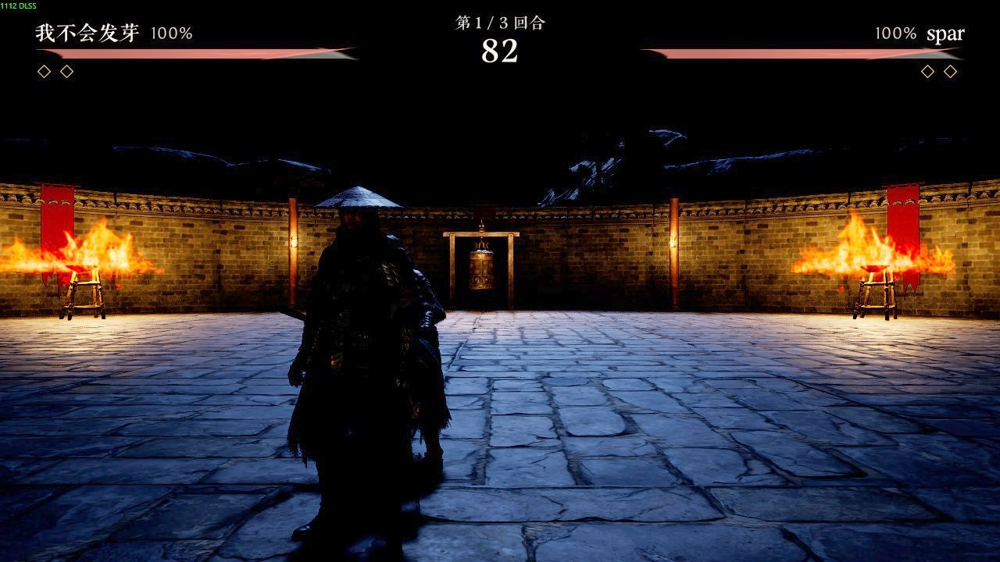
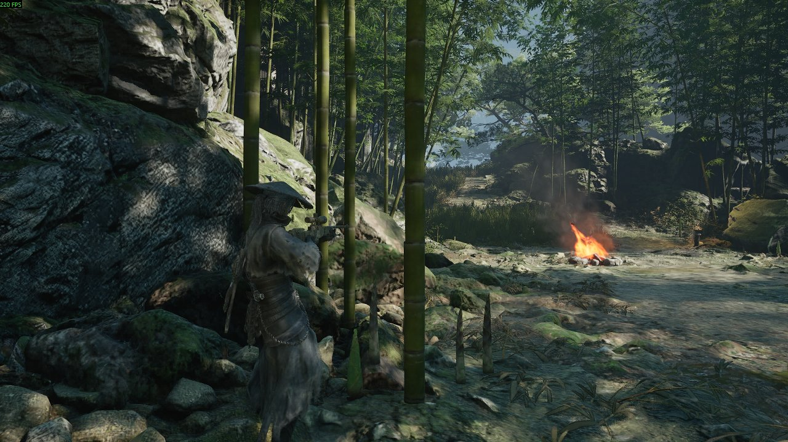
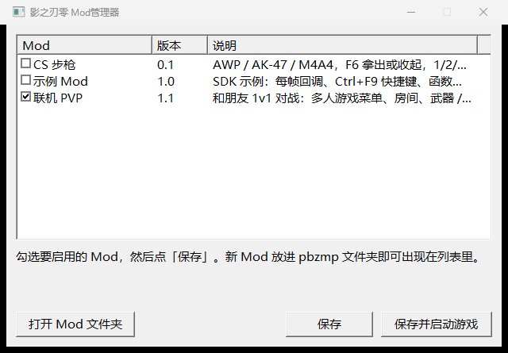

# pbz-modkit

《影之刃零》（Phantom Blade Zero，PC / Steam 版）的非官方 Mod 平台：DLL 加载器、Mod管理器、开发 SDK，以及基于它做的几个 Mod（1v1 联机 PvP、CS 步枪）。

> 非官方项目，与游戏开发商无关。仓库不含任何游戏文件或资源，不解锁付费 DLC。
> 内存偏移和游戏版本绑定（当前适配 UE 5.7 的 PC 版），游戏更新后可能失效。使用 Mod 的风险自负，建议先备份存档。

| 联机大厅 | 比赛中 |
|---|---|
|  |  |
| **CS 步枪（AWP）** | **Mod管理器** |
|  |  |

## 功能一览

**加载器（`version.dll`）**
- 作为 `version.dll` 代理放在 `PBZ.exe` 旁边，系统导出全部转发，不修改游戏文件。
- 在游戏主线程每帧回调 Mod，回调外面套了 SEH 保护：单个 Mod 出错只记日志，不会拖垮游戏。
- 按 `pbzmp\autorun.txt` 加载 Mod，也支持在运行中通过 `pbzmp\cmd.txt` 执行 `run <id>` / `stop <id>`，做热加载和热卸载（加载的是 DLL 副本，可以边改边编）。
- 统一接口：每帧 tick、下一帧执行（post）、日志、函数 Hook（MinHook，同一个目标只允许一个 Mod 挂，冲突时记日志）、全局热键（只在游戏窗口在前台时生效）。Mod 卸载时，它注册过的东西都会自动清理。
- 能和别的 `version.dll` Mod 共存：把对方改名为 `version_chain.dll`，本加载器启动后会顺带加载它。

**Mod管理器（`Mod管理器.exe`）**
- 图形界面勾选启用的 Mod，也可以用命令行：`--list`、`--set a,b`、`--chain`。
- 保存前会检查前置 Mod 和最低版本、互斥的 Mod、Mod 需要的加载器接口版本，有问题时说明原因并拒绝保存。
- 发现外来的 `version.dll` 时，会提示一键串联。

**Mod**
- [`mods/pvp`](mods/pvp/README.md)：1v1 联机对战，支持 Steam P2P 或自建中转服务器。有房间大厅，可以选武器 / 杀器 / 外观，有 3 张擂台地图，比赛不读写存档，崩溃后可以重连。
- [`mods/sniper`](mods/sniper/README.md)：AWP / AK-47 / M4A4，CS2 手感，只能单机用。需要自备资源。
- [`sdk/example`](sdk/README.md)：最小示例，演示 tick、hook 和热键。

## 目录结构

```
pbz-modkit/
├─ build.bat            一键构建，产物都放在 out\
├─ package.py           打玩家包 dist\pbz_pvp-v<版本>.zip
├─ loader/              加载器：main.cpp、host.h（Mod 接口）、proxy_exports.h
├─ modman/              Mod管理器
├─ framework/           UE 5.7 运行时访问，给 Mod 静态链接
│   ├─ ue.cpp/.h          对象表、FName、反射（类 / 属性 / 函数）
│   ├─ ue_call.h          ProcessEvent 的参数封装
│   └─ uex.cpp/.h         查找对象、调用函数、读写属性、日志、存档保护开关
├─ sdk/                 Mod 开发文档和示例
├─ mods/
│   ├─ pvp/               联机 PvP：src/ server/ docs/ maps/
│   └─ sniper/            CS 步枪
├─ tools/               开发用：多开测试实例的启动 / 停止 / 列表脚本
└─ third_party/minhook/
```

依赖关系：Mod 只依赖 `loader/host.h`；要访问 UE 对象时，再链接 `framework/`。加载器和管理器不依赖任何 Mod。

## 安装（玩家）

1. 在 Steam 里右键游戏，选「管理 → 浏览本地文件」，进入 `platform\steam\`（`PBZ.exe` 所在的文件夹）。
2. 把发布包解压到这里，得到 `version.dll`、`Mod管理器.exe`、`pbzmp\`。
3. 用 Mod管理器勾选要启用的 Mod 并保存，然后正常启动游戏。

卸载：删掉 `version.dll`、`Mod管理器.exe` 和 `pbzmp\` 即可。如果之前串联过别的 Mod，把 `version_chain.dll` 改回 `version.dll`。

PvP 的详细玩法和开服说明见 [mods/pvp/README.md](mods/pvp/README.md)。

## 从源码构建

需要：
- Visual Studio 2022（Build Tools 就够），带 x64 的 C++ 工具链
- Python 3（打包脚本、PvP 服务器和测试要用）
- 可选：Node.js，用来转换 sniper 的模型

```bat
build.bat            :: 编译全部：version.dll modman.exe mp.dll sniper.dll example.dll nettest.exe rsrv.exe
python package.py    :: 生成 dist\pbz_pvp-v<版本>.zip（版本取 mods/pvp/mp.txt 的 version=）
python package.py --full   :: 本地自测包，额外带 CS 步枪和本地资源，不要发布
```

`build.bat` 会自动调用 VS 2022 Build Tools 的 `vcvars64.bat`。如果你装的是其他版本，先在「x64 Native Tools Command Prompt」里运行它，或者修改脚本开头的 `VCVARS`。

开发时把 `out\` 里的 DLL 复制到游戏的 `platform\steam\pbzmp\`，再往 `pbzmp\cmd.txt` 写一行 `stop mp` / `run mp`，就能热重载，不用重启游戏。

## 测试

```bat
out\nettest.exe                                   :: 网络层：本机回环、模拟丢包抖动、双进程大厅测试
python mods\pvp\server\test_server.py             :: 中转服务器的协议、阶段、超时、限流测试
set PBZMP_CPP_SERVER=%CD%\out\rsrv.exe
python mods\pvp\server\test_server.py             :: 同一套测试，跑 C++ 版服务器
```

在游戏里测试可以多开实例：设置 `PBZ_ROOT` 为游戏目录，然后运行 `tools\launch.ps1 <标签>`。每个标签使用独立的 `platform\steam\<标签>\` Mod 目录，窗口不抢焦点，默认静音。`tools\stop.ps1` 用来关掉它们。

## 写一个 Mod

Mod 就是一个 DLL，导出 `PbzInit(const PbzHost*)`（可选 `PbzUnload()` 支持热卸载）：

```cpp
#include "pbz_host.h"
static const PbzHost* g;
static void Tick(void*, float dt) { /* 每帧在游戏线程执行 */ }
extern "C" __declspec(dllexport) void PbzInit(const PbzHost* h) {
    g = h; h->addTick(Tick, nullptr); h->log(L"hello");
}
extern "C" __declspec(dllexport) void PbzUnload() { /* 撤销自己生成的东西；tick/hook/热键由加载器清理 */ }
```

把它放到 `pbzmp\<id>.dll` 或 `pbzmp\<id>\<id>.dll`，旁边放一个同名的 `<id>.txt`，描述名称、版本、前置、冲突、接口版本、能否联机。完整接口、信息文件格式和构建方法见 [sdk/README.md](sdk/README.md)。

## 许可

本仓库代码采用 MIT 许可，见 [LICENSE](LICENSE)。`third_party/minhook` 采用 BSD 2-Clause 许可。
游戏本体、游戏资源，以及 sniper 用到的第三方模型和音效，都不在本许可范围内，也不随仓库分发。
