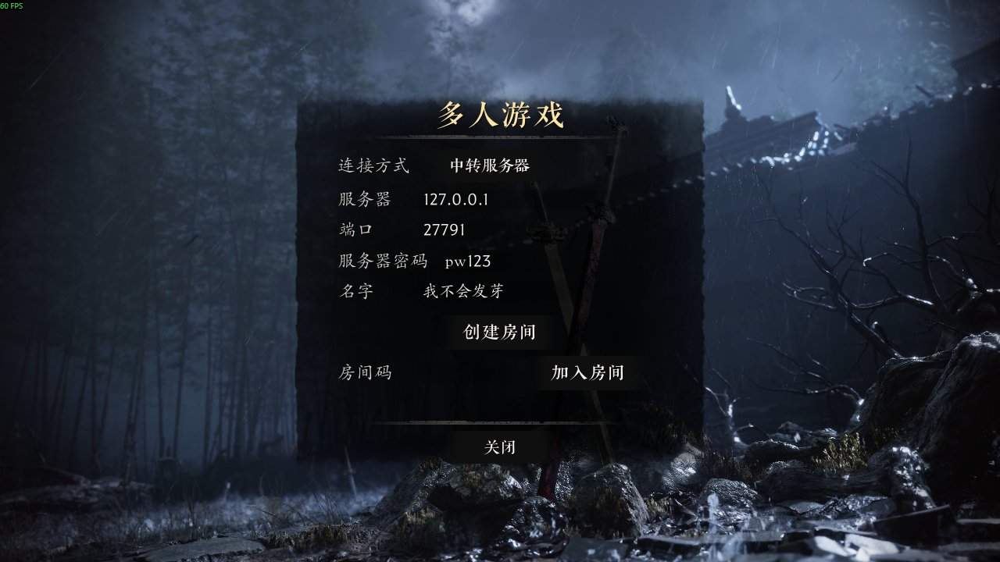
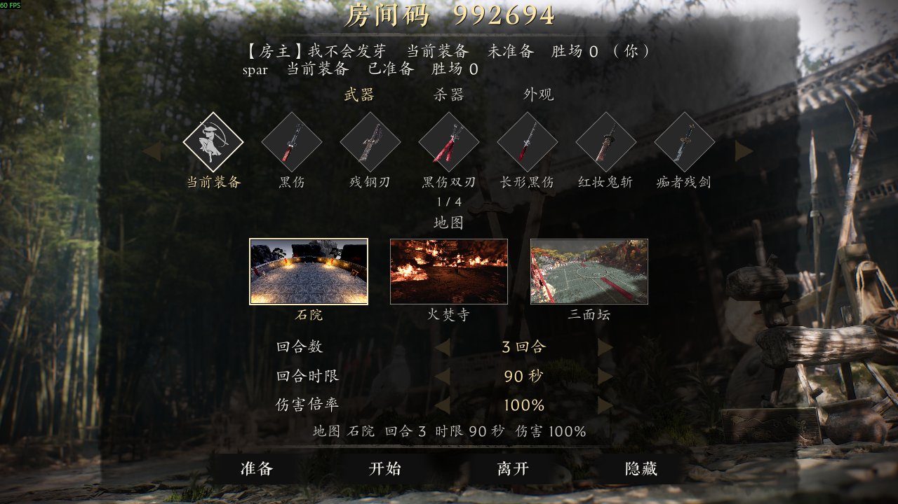
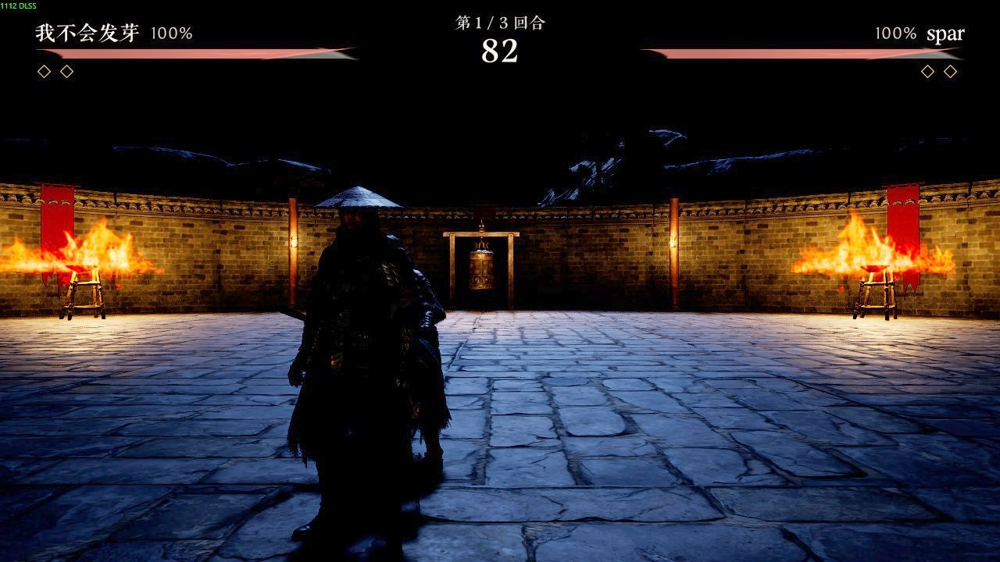

# 联机 PvP

和朋友在《影之刃零》里 1v1 对战：标题页多出「多人游戏」，建房间、选武器 / 杀器 / 外观和擂台地图，打 BO3。支持 Steam 联机（不用架服务器）和自建中转服务器两种连接方式。

## 安装

1. 把压缩包直接解压到游戏目录的 `platform\steam\` 文件夹（和 `PBZ.exe` 同一层）。
   Steam 里右键游戏 → 管理 → 浏览本地文件，再进 `platform\steam`。
2. 正常启动游戏，标题页会多出「多人游戏」。

## Mod管理器

- 双击 `Mod管理器.exe`，勾选要启用的 Mod，点「保存」，下次启动游戏生效。
- 以后的新 Mod 放进 `pbzmp` 文件夹（一个 dll，或一个同名子文件夹），就会出现在管理器的列表里。
- 管理器会检查前置 Mod 和版本、互相冲突的 Mod、需要更新加载器的 Mod，有问题时不让保存并说明原因。
- 已经装了别的 Mod 的 `version.dll`：管理器打开时会提示，点「是」把它改名为 `version_chain.dll`，
  再把本包的 `version.dll` 放回去，两个就都能生效（本加载器会顺带加载 `version_chain.dll`）。
- 联机时双方会交换启用的 Mod 列表：版本不同会提示，标记为禁止联机（`mp=block`）的 Mod 在进房间时自动卸载、离开房间后自动重新加载；对方用的是不会自动卸载的旧版本并开着这类 Mod 时不能开始。

## 方式一：Steam 联机（不用架服务器）

1. 「多人游戏」→ 点连接方式切到「Steam 联机」→ 创建房间，把房间码发给朋友。
2. 朋友同样切到「Steam 联机」，填房间码 → 加入房间。
3. 两人都要登录 Steam。房主离开房间，房间就没了。

## 方式二：中转服务器（一人当服务器）

1. 双击 `server\开服务器.bat`（不用装任何东西），窗口开着服务器就在运行。
   - 想加密码：用记事本打开 `开服务器.bat`，把 `rsrv.exe --port 27777` 改成 `rsrv.exe --port 27777 --password 口令`。
   - 在 Linux 服务器上可以用 Python 3 版：`python3 server/pbzmp_server.py --port 27777`（部署说明见 [docs/pvp-protocol.md](docs/pvp-protocol.md)）。
2. 路由器把 UDP 27777 转发到这台电脑，或者用有公网 IP 的机器跑服务器。
3. 游戏里「多人游戏」→ 填服务器 IP、端口（有密码就填密码）→ 创建房间，把房间码发给朋友。
4. 朋友填同样的 IP、端口、密码和房间码 → 加入房间。

## 房间里

- 选武器（25 把）和杀器（24 把），上方「武器 / 杀器 / 外观」切换，左右箭头翻页。房主选地图（石院 / 火焚寺 / 三面坛）、回合数、回合时限、伤害倍率，全员准备后开始。
- 杀器要求存档里已经装备了一把杀器（比赛时临时换成你选的那把）；存档没装备杀器时，开局会提示所选杀器本局不生效。
- 比赛中按 Esc 打开菜单，可以离开比赛（算认输）。

## 说明

- 外观页可选 8 套外观（DLC 外观只有账号拥有时才会穿上，否则本局用你自己的外观），对手看到的是你选的外观。
- 多人模式不读也不写存档，赛后回到原来的位置、武器、杀器和外观。
- 打过联机比赛后，单机存档要重启游戏才会恢复（防止竞技场里的状态写进你的存档）。想继续单机，先退出游戏再打开。
- 比赛中游戏崩溃：两分钟内重新打开游戏，会自动连回房间和竞技场（中转服务器模式）。
- 服务器地址、昵称、密码和连接方式会记住，下次不用再填。
- 服务器没有账号和加密，只适合和信任的人玩。
- 卸载：删掉 `version.dll`、`Mod管理器.exe`、`pbzmp` 和 `server` 文件夹。

## 开发者

| 路径 | 内容 |
|---|---|
| `src/mp.cpp`、`src/fileguard.*` | 入口、关卡切换；比赛期间在 Win32 层拒绝写存档 |
| `src/ui/` | 多人菜单、大厅、比赛 HUD、Esc 菜单 |
| `src/net/` | 客户端协议、Steam P2P 通道、C++ 房间服务器、`nettest` 链路测试 |
| `src/arena/` | 擂台地图加载、清场 |
| `src/fight/` | 对手角色同步（位置、动画蒙太奇、受击）、武器 / 杀器、外观 |
| `server/` | Python 中转服务器（参考实现）和协议测试 |
| `docs/` | [设计](docs/pvp-design.md)、[大厅协议](docs/pvp-protocol.md)、[游戏通道 / 网络同步](docs/pvp-netcode.md) |
| `maps/` | 大厅里的地图预览图 |

Mod 信息文件是 `mp.txt`（id 为 `mp`，安装后位于 `pbzmp\mp.dll`）。构建和测试见仓库根目录的 [README](../../README.md)。
